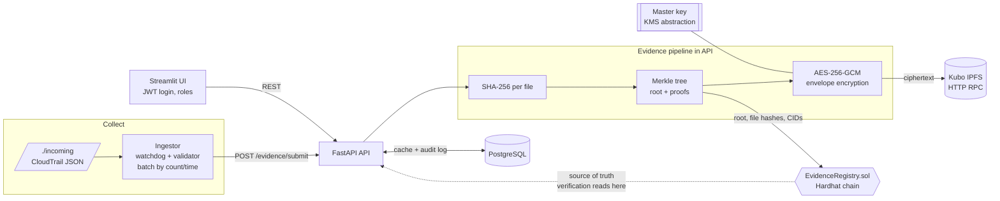

# BVES: Blockchain-Based Verifiable Evidence System for Cloud Intrusions

Capture simulated AWS CloudTrail intrusion logs → hash → Merkle tree → AES-256-GCM encrypt →
store on IPFS → anchor the Merkle root on a local Ethereum chain → verify any file later and
see a full chain of custody. A B.Tech minor project; it favours clarity and demo-ability.

## Architecture



**Source of truth:** the chain. PostgreSQL is only a cache/index (filenames, search, audit log).
`/evidence/verify` and `/evidence/{id}` always read the contract; clearing the DB doesn't break
verification (the API rebuilds the cache from chain on start).

## Quick start (4 commands)

Requires Docker with the Compose plugin and Python 3.11+ (only for the demo script).

```bash
cp .env.example .env                 # 1. config (edit JWT_SECRET!)
docker compose up --build -d         # 2. api, ui, ipfs, hardhat-node, postgres, ingestor
pip install requests cryptography    # 3. demo script deps
python scripts/tamper_demo.py        # 4. submit samples, flip one byte, watch verification fail
```

* UI: <http://localhost:8501>  ·  API docs (OpenAPI): <http://localhost:8000/docs>
* Demo users: `investigator` / `auditor` / `admin`, passwords from `.env`
  (defaults `investigator123`, `auditor123`, `admin123`).
* First build downloads the Solidity compiler and Kubo, so it needs internet and takes a few minutes.
* `docker compose down -v` resets everything (the dev chain is wiped on restart; the API detects
  that and clears the stale cache).

## Demo walkthrough

1. **Submit** (UI → *Submit Evidence*, as `investigator`): upload the files in `./samples`
   (failed console logins, privilege escalation, S3 exfiltration, root account usage). You get the
   batch id, Merkle root, CIDs, tx hash and gas used. *(Or copy the files into `./incoming`:
   the ingestor validates them, batches them, and submits through the API.)*
2. **Verify**: *Verify* page → drag in an original sample → green **VERIFIED**, with the Merkle
   proof path, tx hash, block, timestamp and custody timeline.
3. **Tamper**: open a sample in an editor, change one character, save a copy, drag it in →
   red **TAMPERED** with expected vs computed hash and the root that no longer matches.
   `scripts/tamper_demo.py` automates this and also flips a byte of the *encrypted* IPFS blob to
   show AES-GCM rejecting it.
4. **Custody**: *Batches* → open a batch → *Transfer custody* to another address (e.g. a Hardhat
   account); the timeline gains an on-chain entry.
5. **Audit**: log in as `auditor` → *Audit Log* shows who did what, when, with tx hashes.

Drop-folder demo:

```bash
cp samples/*.json incoming/        # files move to incoming/processed/ after anchoring
```

## Roles

| Role | Can |
|---|---|
| investigator | submit, verify, list/view, transfer custody, download (decrypt) |
| auditor | list/search/view, verify, read audit log (read-only) |
| admin | list/view, verify, read audit log |

API roles are enforced by the backend. On-chain, the backend's signer holds `INVESTIGATOR_ROLE`
(and the deployer `ADMIN_ROLE`); see [ARCHITECTURE.md](ARCHITECTURE.md) for what that implies.

## API summary

| Method & path | Role | Purpose |
|---|---|---|
| `POST /auth/login` | – | JWT |
| `POST /evidence/submit` | investigator | multipart `case_id` + `files[]` → batch id, root, CIDs, tx hash |
| `POST /evidence/verify` | inv, aud, admin | upload file → `VERIFIED` / `TAMPERED` (or `NOT_FOUND`) + detail |
| `GET /evidence`, `/evidence/{id}`, `/evidence/{id}/custody` | any | list (cache) / detail (chain) / custody (chain) |
| `POST /evidence/{id}/transfer` | investigator | append custody transfer on-chain |
| `GET /evidence/{id}/download` | investigator | IPFS → decrypt → check hash (ZIP if multi-file) |
| `GET /audit-log`, `GET /stats`, `GET /health` | auditor/admin, any, – | audit trail, dashboard, health |

Errors are JSON: `{"error": {"code", "message", "request_id"}}`. Logs are structured JSON.

## Tests and evaluation

```bash
pip install -r requirements.txt && npm install
make test            # pytest (crypto, Merkle, IPFS, ingestor, pipeline, API) + Hardhat contract tests
make evaluate        # needs the stack running: tamper accuracy, latency, gas, round trip
make evaluate-offline  # in-memory chain/IPFS: tamper accuracy + round trip only (no real gas)
```

`evaluate.py` writes `eval_results/*.csv` and `eval_results/report.md` (Markdown tables for your
report). Expected: 100% tamper detection and 100% round-trip success.

## Threat model

**What BVES protects against**

* **Modification, deletion or reordering of evidence after anchoring.** Any change to a file (even
  one bit) changes its SHA-256, which no longer matches the on-chain record, and the Merkle proof no
  longer reaches the anchored root.
* **A malicious or compromised database.** The DB is a cache; verification recomputes everything from
  contract state. The contract has no update/delete functions, so history is append-only.
* **Tampering with stored files.** IPFS is content-addressed, and files are AES-256-GCM encrypted,
  so a modified blob fails authentication and decrypted output is re-checked against the on-chain hash.
* **Unauthorised registration or custody changes**, via contract roles (OpenZeppelin AccessControl).
* **Plaintext exposure at rest.** Evidence is encrypted before leaving the API; per-file data keys
  are wrapped by a master key; no plaintext or key material is written to the DB, IPFS or chain.
* **Back-dating** (partially): the block timestamp proves the root existed no later than that block.

**What it does NOT protect against**

* **Authenticity before collection.** BVES proves integrity *after* anchoring. If a log was forged
  or altered before it reached `./incoming`, it is anchored faithfully as-is. (Mitigation outside
  scope: CloudTrail log-file validation, signed digests, collecting directly from S3 with Object Lock.)
* **A compromised ingestor, API or signer key** can anchor false evidence (it cannot alter past
  records, and the act is permanently recorded). The backend uses a single chain key, so the on-chain
  `submitter` is the service; the human actor is only in the off-chain audit log, which a DB admin
  could edit. (Mitigation: per-user keys/signatures, anchoring audit-log digests.)
* **Master-key compromise or loss**: compromise exposes confidentiality; loss makes stored files
  unrecoverable (hashes on-chain still prove integrity of copies you hold).
* **Availability.** If every IPFS copy is unpinned/lost, the files are gone; the chain only proves
  what they *were*. Keep pins and backups.
* **Metadata privacy.** File hashes, CIDs, case IDs, timestamps and batch sizes are public on-chain
  (anyone holding a known file can confirm it was registered).
* **Decentralisation.** The demo uses one local Hardhat node that anyone with the node can reset.
  A real deployment needs a permissioned/consortium chain or a public L2 and proper key management
  (KMS/HSM, per-user wallets).
* **Demo-grade auth** (static seeded users, local-file master key, well-known Hardhat private key).

## Repository layout

```
contracts/ test/ scripts/deploy.js   Solidity + Hardhat tests + deploy (writes shared/deployment.json)
core/crypto/                         sha256, Merkle tree, AES-GCM envelope, key provider (KMS abstraction)
core/{ipfs,chain,pipeline,verify}.py Kubo RPC client, web3.py v7 client, pipeline, verification
api/                                 FastAPI app, SQLAlchemy models, JWT/RBAC, routes; migrations/ = Alembic
ingestor/                            watchdog monitor, CloudTrail validator, batcher
ui/                                  Streamlit multipage app
scripts/                             tamper_demo.py, evaluate.py, generate_samples.py
samples/                             simulated CloudTrail intrusion logs
tests/                               pytest suite (+ in-memory fakes of chain and IPFS)
docker/ docker-compose.yml Makefile .env.example
```

## Local (non-Docker) development

```bash
npm install && npx hardhat node                                  # terminal 1
npx hardhat run scripts/deploy.js --network localhost            # terminal 2 (writes shared/deployment.json)
ipfs daemon                                                      # terminal 3 (or any Kubo node on :5001)
cp .env.example .env && make api                                 # terminal 4 (SQLite by default)
make ui                                                          # terminal 5
```

Format/lint: `make fmt` / `make lint` (ruff + black, configured in `pyproject.toml`).
